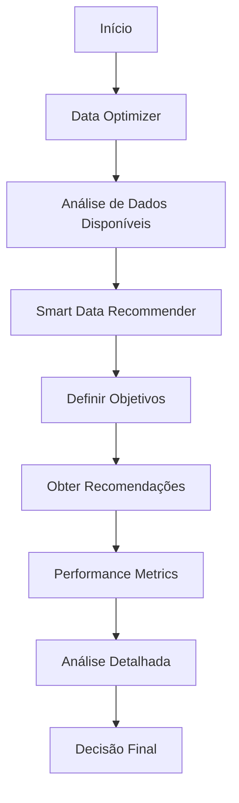

# Guia Completo de Otimização de Dados para ML Forex

## 📋 Índice

1. [Visão Geral](#visão-geral)
2. [Componentes do Sistema](#componentes-do-sistema)
3. [Instalação e Configuração](#instalação-e-configuração)
4. [Guia de Uso](#guia-de-uso)
5. [Exemplos Práticos](#exemplos-práticos)
6. [Interpretação de Resultados](#interpretação-de-resultados)
7. [Melhores Práticas](#melhores-práticas)
8. [Troubleshooting](#troubleshooting)
9. [FAQ](#faq)

## 🎯 Visão Geral

Este sistema de otimização de dados foi desenvolvido para resolver um dos principais desafios no treinamento de modelos de Machine Learning para Forex: **determinar a quantidade ideal de dados históricos**.

### Problemas Resolvidos

- ❌ **Underfitting**: Poucos dados resultam em modelos com baixa performance
- ❌ **Overfitting**: Muitos dados podem causar overfitting e lentidão
- ❌ **Desperdício de Recursos**: Uso ineficiente de memória e tempo de processamento
- ❌ **Falta de Robustez**: Modelos instáveis em diferentes condições de mercado

### Soluções Oferecidas

- ✅ **Recomendações Inteligentes**: Baseadas em recursos do sistema e objetivos
- ✅ **Análise de Trade-offs**: Performance vs. Robustez vs. Eficiência
- ✅ **Métricas Abrangentes**: Avaliação completa de qualidade dos modelos
- ✅ **Visualizações**: Gráficos para análise visual dos resultados

## 🧩 Componentes do Sistema

### 1. Data Optimizer (`data_optimizer.py`)

**Propósito**: Análise e otimização de dados de múltiplas fontes

**Funcionalidades**:
- Análise de dados CSV locais e Yahoo Finance
- Configurações predefinidas (minimal, light, balanced, robust, maximum)
- Avaliação de qualidade de dados
- Estimativas de tempo e memória
- Relatórios de otimização

**Quando Usar**:
- Análise inicial de dados disponíveis
- Comparação entre fontes de dados
- Avaliação de qualidade dos dados

### 2. Smart Data Recommender (`smart_data_recommender.py`)

**Propósito**: Recomendações inteligentes baseadas em objetivos e recursos

**Funcionalidades**:
- Análise automática de recursos do sistema
- Objetivos personalizáveis (accuracy, speed, robustness)
- Recomendações para diferentes propósitos (testing, production, research)
- Alternativas e justificativas
- Avisos e limitações

**Quando Usar**:
- Definição de estratégia de treinamento
- Otimização para recursos limitados
- Planejamento de experimentos

### 3. Performance Robustness Metrics (`performance_robustness_metrics.py`)

**Propósito**: Análise detalhada de trade-offs entre performance e robustez

**Funcionalidades**:
- Métricas de performance (accuracy, precision, recall, F1)
- Métricas de robustez (stability, generalization, noise resistance)
- Análise comparativa de diferentes quantidades de dados
- Visualizações e relatórios detalhados
- Recomendações específicas por propósito

**Quando Usar**:
- Análise aprofundada de modelos
- Comparação de configurações
- Validação de estratégias

## 🚀 Instalação e Configuração

### Pré-requisitos

```bash
# Instalar dependências
pip install pandas numpy matplotlib seaborn scikit-learn psutil yfinance
```

### Verificação da Instalação

```python
# Teste rápido
from smart_data_recommender import SmartDataRecommender
from data_optimizer import DataOptimizer
from performance_robustness_metrics import PerformanceRobustnessAnalyzer

print("✅ Todos os componentes instalados com sucesso!")
```

## 📖 Guia de Uso

### Fluxo Recomendado



### Passo 1: Análise de Dados Disponíveis

```python
from data_optimizer import DataOptimizer

# Criar otimizador
optimizer = DataOptimizer()

# Analisar dados disponíveis
data_info = optimizer.analyze_available_data(
    csv_directory="C:/path/to/csv/data",  # Opcional
    yahoo_pairs=['EURUSD=X', 'GBPUSD=X', 'USDJPY=X']
)

print(f"Pares disponíveis: {data_info['available_pairs']}")
print(f"Qualidade dos dados: {data_info['data_quality_score']:.2f}")
```

### Passo 2: Definir Objetivos e Obter Recomendações

```python
from smart_data_recommender import SmartDataRecommender, create_training_objective

# Criar recomendador
recommender = SmartDataRecommender()

# Definir objetivos para produção
objective = create_training_objective(
    purpose='production',
    accuracy_priority=8.0,
    speed_priority=6.0,
    robustness_priority=9.0,
    max_training_time_hours=2.0,
    target_pairs=['EURUSD=X', 'GBPUSD=X', 'USDJPY=X']
)

# Obter recomendação
recommendation = recommender.recommend_data_amount(objective)

print(f"Recomendação: {recommendation.samples_per_pair:,} amostras por par")
print(f"Período: {recommendation.period_description}")
print(f"Confiança: {recommendation.confidence_score:.1%}")
```

### Passo 3: Análise Detalhada de Performance vs. Robustez

```python
from performance_robustness_metrics import run_comprehensive_analysis

# Executar análise abrangente
data_sizes = [50000, 100000, 200000, 300000, 500000]
report = run_comprehensive_analysis(data_sizes)

# Visualizar resultados
print("Melhores configurações:")
for purpose, config in report['best_configurations'].items():
    print(f"  {purpose}: {config['sample_size']:,} amostras")
```

## 💡 Exemplos Práticos

### Exemplo 1: Desenvolvimento Rápido

```python
# Objetivo: Testes rápidos e iterações
objective = create_training_objective(
    purpose='testing',
    accuracy_priority=5.0,
    speed_priority=10.0,
    robustness_priority=3.0,
    max_training_time_hours=0.5,
    target_pairs=['EURUSD=X']
)

recommendation = recommender.recommend_data_amount(objective)
# Resultado típico: ~25,000-50,000 amostras
```

### Exemplo 2: Produção Balanceada

```python
# Objetivo: Sistema em produção
objective = create_training_objective(
    purpose='production',
    accuracy_priority=8.0,
    speed_priority=6.0,
    robustness_priority=9.0,
    max_training_time_hours=3.0,
    target_pairs=['EURUSD=X', 'GBPUSD=X', 'USDJPY=X']
)

recommendation = recommender.recommend_data_amount(objective)
# Resultado típico: ~200,000-500,000 amostras
```

### Exemplo 3: Pesquisa Acadêmica

```python
# Objetivo: Máxima robustez para pesquisa
objective = create_training_objective(
    purpose='research',
    accuracy_priority=9.0,
    speed_priority=3.0,
    robustness_priority=10.0,
    max_training_time_hours=8.0,
    target_pairs=['EURUSD=X', 'GBPUSD=X', 'USDJPY=X', 'AUDUSD=X']
)

recommendation = recommender.recommend_data_amount(objective)
# Resultado típico: ~500,000-1,000,000 amostras
```

## 📊 Interpretação de Resultados

### Métricas de Performance

| Métrica | Descrição | Valores Típicos |
|---------|-----------|----------------|
| **Accuracy** | Precisão geral do modelo | 0.65-0.85 |
| **F1-Score** | Harmônica entre precision e recall | 0.60-0.80 |
| **Training Time** | Tempo de treinamento | 1-60 minutos |
| **Memory Usage** | Uso de memória | 100MB-2GB |

### Métricas de Robustez

| Métrica | Descrição | Valores Desejados |
|---------|-----------|------------------|
| **Stability Score** | Consistência entre execuções | > 0.80 |
| **CV Standard Deviation** | Variabilidade cross-validation | < 0.05 |
| **Generalization Gap** | Diferença train/validation | < 0.10 |
| **Noise Resistance** | Resistência a ruído | > 0.75 |

### Níveis de Recomendação

- 🟢 **Excelente** (Score > 0.85): Configuração ideal
- 🟡 **Recomendado** (Score > 0.75): Boa configuração
- 🟠 **Aceitável** (Score > 0.65): Configuração utilizável
- 🔴 **Limitado** (Score > 0.55): Usar com cautela
- ⚫ **Não Recomendado** (Score ≤ 0.55): Evitar

## 🎯 Melhores Práticas

### 1. Definição de Objetivos

```python
# ✅ BOM: Objetivos claros e balanceados
objective = create_training_objective(
    purpose='production',
    accuracy_priority=7.0,
    speed_priority=6.0,
    robustness_priority=8.0,
    max_training_time_hours=2.0
)

# ❌ RUIM: Prioridades extremas
objective = create_training_objective(
    accuracy_priority=10.0,
    speed_priority=0.0,
    robustness_priority=0.0
)
```

### 2. Seleção de Dados

- **Mínimo Recomendado**: 25,000 amostras (≈17 dias)
- **Produção Típica**: 200,000-500,000 amostras (≈5-12 meses)
- **Máximo Prático**: 1,000,000 amostras (≈2 anos)

### 3. Monitoramento de Recursos

```python
# Verificar recursos antes do treinamento
resources = recommender.system_resources
print(f"Memória disponível: {resources.available_memory_gb:.1f}GB")
print(f"CPU cores: {resources.cpu_cores}")

# Ajustar recomendações se necessário
if resources.available_memory_gb < 4.0:
    print("⚠️ Memória limitada - considere reduzir quantidade de dados")
```

### 4. Validação de Resultados

```python
# Sempre validar recomendações com análise detalhada
if recommendation.confidence_score < 0.7:
    print("⚠️ Baixa confiança - revisar objetivos ou recursos")
    
if recommendation.warnings:
    print("Avisos:")
    for warning in recommendation.warnings:
        print(f"  - {warning}")
```

## 🔧 Troubleshooting

### Problemas Comuns

#### 1. Erro de Memória Insuficiente

```
Erro: MemoryError durante treinamento
```

**Soluções**:
- Reduzir quantidade de dados
- Usar configuração 'light' ou 'minimal'
- Fechar outras aplicações
- Aumentar memória virtual

#### 2. Tempo de Treinamento Muito Longo

```
Problema: Treinamento excede tempo limite
```

**Soluções**:
- Aumentar prioridade de velocidade
- Reduzir número de pares
- Usar menos dados por par
- Otimizar hiperparâmetros

#### 3. Baixa Confiança nas Recomendações

```
Problema: confidence_score < 0.6
```

**Soluções**:
- Revisar objetivos (prioridades muito extremas)
- Verificar recursos do sistema
- Ajustar tempo máximo de treinamento
- Considerar usar dados de melhor qualidade

#### 4. Dados Insuficientes

```
Erro: Não há dados suficientes disponíveis
```

**Soluções**:
- Verificar conectividade para Yahoo Finance
- Confirmar caminhos de arquivos CSV
- Usar período mais longo de dados
- Considerar fontes alternativas

### Logs e Debugging

```python
# Habilitar logs detalhados
import logging
logging.basicConfig(level=logging.DEBUG)

# Salvar relatórios para análise
report_file = recommender.save_recommendation(recommendation)
print(f"Relatório salvo: {report_file}")
```

## ❓ FAQ

### Q1: Qual a diferença entre os três componentes?

**A**: 
- **Data Optimizer**: Análise geral de dados disponíveis
- **Smart Recommender**: Recomendações baseadas em objetivos
- **Performance Metrics**: Análise detalhada de trade-offs

### Q2: Posso usar apenas dados do Yahoo Finance?

**A**: Sim, o sistema funciona apenas com Yahoo Finance. CSV é opcional.

### Q3: Como interpretar o confidence_score?

**A**: 
- > 0.8: Alta confiança
- 0.6-0.8: Confiança moderada
- < 0.6: Baixa confiança (revisar parâmetros)

### Q4: Qual configuração usar para backtesting?

**A**: Use purpose='backtesting' com alta prioridade de robustez (8-10) e dados de pelo menos 1 ano.

### Q5: Como otimizar para múltiplos pares?

**A**: O sistema automaticamente ajusta recomendações baseado no número de pares. Mais pares = menos dados por par.

### Q6: Posso modificar as curvas de eficiência?

**A**: Sim, edite os dicionários em `_load_efficiency_curves()` baseado em sua experiência.

### Q7: Como validar as recomendações?

**A**: Use o Performance Metrics para análise detalhada e compare com resultados reais.

### Q8: O sistema funciona para outros mercados?

**A**: Foi otimizado para Forex, mas pode ser adaptado para outros mercados financeiros.

## 📈 Roadmap

### Próximas Funcionalidades

- [ ] Integração com mais fontes de dados
- [ ] Otimização automática de hiperparâmetros
- [ ] Análise de correlação entre pares
- [ ] Recomendações baseadas em volatilidade
- [ ] Interface web para facilitar uso
- [ ] Integração com MLflow para tracking

### Melhorias Planejadas

- [ ] Curvas de eficiência baseadas em dados reais
- [ ] Suporte a diferentes timeframes
- [ ] Análise de sazonalidade
- [ ] Otimização para diferentes algoritmos ML

---

## 📞 Suporte

Para dúvidas ou problemas:

1. Consulte este guia
2. Verifique os logs de erro
3. Teste com configurações mais simples
4. Documente o problema com detalhes

**Lembre-se**: Este sistema é uma ferramenta de apoio à decisão. Sempre valide recomendações com seus próprios testes e experiência de domínio.